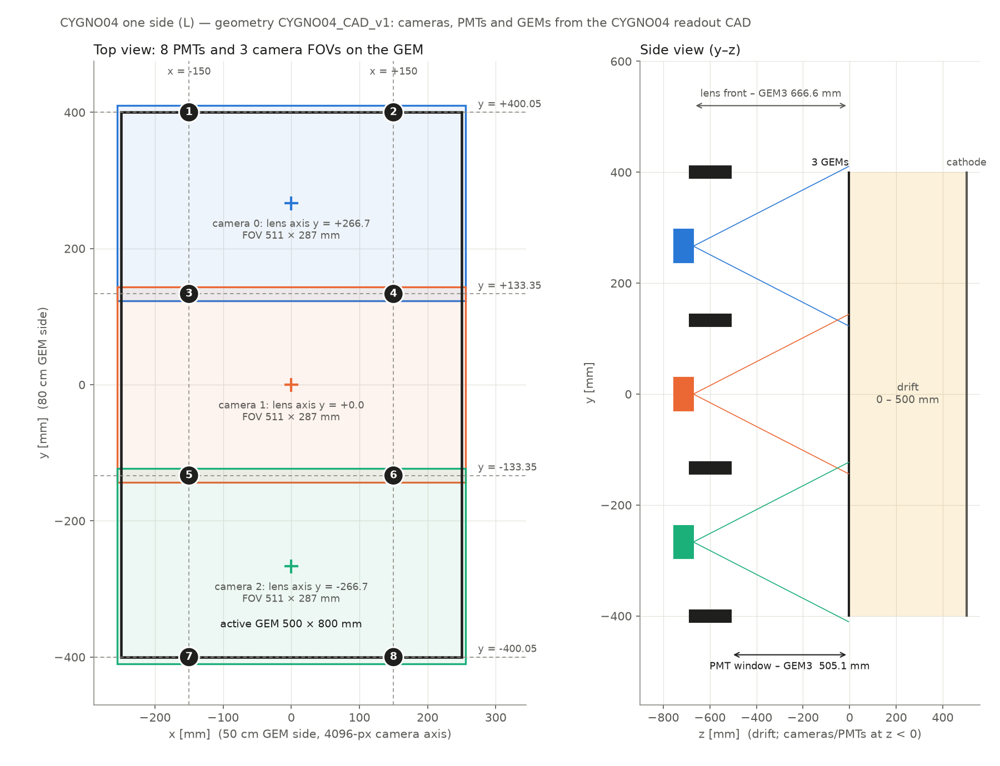

# `twin-cygno04` vs `main`: what changes in the digitizer

Branch `twin-cygno04` of `Oppedix/digitizationpp` = **upstream `CYGNUS-RD/digitizationpp` `main`
(`f250be5`, 2026-11-04) + the additions below**. Fork `main` is an exact copy of upstream `main`.
Line numbers refer to this branch. They are written as `file:line` and link to the line on GitHub.

**Rule kept throughout:** with no new keys, or the new keys at their defaults, the digitizer does what upstream
`main` does. Every addition is either a new option or runs only under `twin_cygno04_mode: True`.

## 1. Ways to run it

| Mode | Config | What you get |
|---|---|---|
| **Standard (upstream)** | `config/ConfigFile_new.txt` (LIME, 4 PMTs) | Same output as upstream `main` (§2) |
| **CYGNO04, 1 camera + 8 PMTs** | `config/ConfigFile_CYGNO04_8PMT.txt` | Standard digitizer with `pmt_number: 8`: Quest2 central camera and 8 waveform pairs `wav_fast/slow_pmt1..8`. All legacy options still work (pedestal `bckg`, `Vignetting`, `redpix_output`, `digitizers`, random shifts, `fixed_seed`, PSD noise) |
| **TWIN ML datasets** | `config/ConfigFile_TWIN_CYGNO04.txt` | `twin_cygno04_mode: True`: camera choice and paired depths, `ml_*`/`obs_*` truth records ([TWIN_SCHEMA.md](TWIN_SCHEMA.md)) |

The standard digitizer also runs camera-only (`pmt_mode: False`) or with any 1–8 PMTs (`pmt_number`).
Step-by-step recipes for every mode: [TWIN_SCHEMA.md, Usage](TWIN_SCHEMA.md#usage). Output of each mode: §5.

## 2. Verified identical to upstream `main`

I built upstream `main` and this branch with the same dependency stubs: no ROOTANA, and the OpenCV
noise IFFT replaced by zero noise. Both ran on the same 7-event MC fixture (ER, He NR, a GEM-crossing
track, a track crossing `max_drift`, an empty event, a sub-`ion_pot` event, a long track) with upstream's
`ConfigFile_new.txt`, `fixed_seed: True` and `bckg: False`.

* `redpix_output: True`: the 35 scalar and redpix branches and all `param_dir` values are identical.
  PMT waveform lengths are identical too; their values are random in both versions (non-seeded `random_device`).
* `redpix_output: False`: all 7 camera images are **pixel-identical**.
* The only differences:
  * (a) a new branch `pmt_signal_valid`;
  * (b) `particle_type` of the empty event. Upstream reads `pdgID_hits[0]` of an empty vector, which is
    undefined behaviour; this branch writes 0 ([DigitizationRunner.cxx:870](../src/DigitizationRunner.cxx#L870)).
* The run had to use `min_drift: 1e-6`, because upstream `main` **aborts on the first event with its own
  default `min_drift: 0`** (§3).

## 3. Upstream PR #59 (`min_drift` / `max_drift`) merged, one bug fixed

Upstream replaced `drift_length` with the response interval `[min_drift, max_drift]`, with defaults 0 and 510 mm.
Its check `min_drift <= 0 → throw` rejects the default 0, so every run with `ConfigFile_new.txt` stops.
This branch moves the check into one helper, [DriftRange.h:11](../include/DriftRange.h#L11), used by both the
runner and TWIN:

* **Rules:** `0 <= min_drift < max_drift`, and both values must be finite numbers. The defaults stay 0 and 510.
* **Order check:** a swapped pair (`min_drift: 300`, `max_drift: 200`) or an empty interval is rejected.
  Upstream would accept it and silently select no deposits.
* **Removed key:** an old `drift_length` key now raises a clear error instead of being silently ignored.
* **When it runs:** once in the constructor ([DigitizationRunner.cxx:54](../src/DigitizationRunner.cxx#L54)), before any
  output is opened. The interval is applied at [:1131](../src/DigitizationRunner.cxx#L1131)–[:1134](../src/DigitizationRunner.cxx#L1134).
* **TWIN:** requires exactly 0 and 500 mm ([TwinPlacement.h:47](../include/TwinPlacement.h#L47)).
* **Tests:** [test_twin.cxx:98](../tests/test_twin.cxx#L98) covers the defaults, the shipped values, the swapped and empty
  intervals, negative/NaN/inf/non-numeric values, `drift_length`, and the TWIN 0–500 requirement.
* **Configs:** every config states the rule on its `min_drift`/`max_drift` lines
  ([ConfigFile_new.txt:25](../config/ConfigFile_new.txt#L25)–26).
* Upstream's second commit (`a079ff8`, setSeed revert) changes nothing here; this branch already had that `setSeed`.

The three earlier drift-boundary fixes (fractional negative z, z ≥ 0 only, upper cut) are already upstream.

## 4. Changes, row by row

Each row gives where the change is, what it does, and how. Rows in §4.1–4.4 apply to every mode. Rows in §4.5
run only with `twin_cygno04_mode: True`; with it off, the standard path is the upstream one (§2).

### 4.1 Drift interval (all modes)

| Code | What changed | How |
|---|---|---|
| [DriftRange.h:11](../include/DriftRange.h#L11) | New helper `activeDriftRange` | Reads `min_drift`/`max_drift` (defaults 0 and 510 mm). Rejects text that is not a number, negative/NaN/infinite values, `max_drift <= min_drift`, and the removed key `drift_length` |
| [DigitizationRunner.cxx:54](../src/DigitizationRunner.cxx#L54) | Checked at start-up | A bad interval stops the run before any output file or download |
| [DigitizationRunner.cxx:1131](../src/DigitizationRunner.cxx#L1131)–[:1134](../src/DigitizationRunner.cxx#L1134) | Interval applied | Only deposits with `min_drift <= z <= max_drift` produce light. Track metadata still uses every hit |

### 4.2 PMTs: 1–8 channels (all modes)

| Code | What changed | How |
|---|---|---|
| [PMTHits.cxx:17](../src/PMTHits.cxx#L17), [PMTHits.h:44](../include/PMTHits.h#L44) | New `validateGeometry` | `pmt_number` must be a whole number 1–8. Every `pmt_N_x/y`, `pmt_radius` and `dist_gem_pmt` must be a finite number, radius and distance positive. A `'REQUIRED'` placeholder fails |
| [DigitizationRunner.cxx:60](../src/DigitizationRunner.cxx#L60) | Called at start-up | Geometry errors stop the run before any download |
| [PMTSignal.cxx:163](../src/PMTSignal.cxx#L163)–165 | Waveforms for `pmt_1..pmt_number` | Upstream always simulated 4 PMTs |
| [DigitizationRunner.cxx:704](../src/DigitizationRunner.cxx#L704) | Output arrays sized by `pmt_number` | Sized once and never resized, because ROOT keeps the addresses |
| [DigitizationRunner.cxx:782](../src/DigitizationRunner.cxx#L782) | Output branches | `wav_fast_pmtN` / `wav_slow_pmtN` for N = 1..`pmt_number` (LIME names unchanged), plus the new `pmt_signal_valid` |
| [DigitizationRunner.cxx:1249](../src/DigitizationRunner.cxx#L1249) | `pmt_signal_valid` filled | 1 if that PMT collected at least one photoelectron, else 0 |
| [DigitizationRunner.cxx:802](../src/DigitizationRunner.cxx#L802) | Per-event reset | Events without light keep **empty** waveforms, as upstream. Only TWIN fills them with zeros to the window length |

### 4.3 PMT noise options (all modes)

| Code | What changed | How |
|---|---|---|
| [PMTSignal.cxx:196](../src/PMTSignal.cxx#L196), [:238](../src/PMTSignal.cxx#L238) | New key `pmt_noise` | Accepts `True/true/1` or `False/false/0`, anything else is an error. Missing means `True` (upstream behaviour). `False` sets the noise to zero and skips the template download |
| [PMTSignal.cxx:203](../src/PMTSignal.cxx#L203), [:245](../src/PMTSignal.cxx#L245) | New key `pmt_noise_channels` | `';'`-separated positive integers, one per PMT. PMT *i* reads the noise template of channel *list[i]*. Missing means PMT *i* uses template *i*, as upstream |
| [PMTSignal.cxx:271](../src/PMTSignal.cxx#L271) | PSD length check | A missing or too-short template is an error. Upstream read past the end of the array |

### 4.4 Small fixes (all modes)

| Code | What changed | How |
|---|---|---|
| [DigitizationRunner.cxx:870](../src/DigitizationRunner.cxx#L870) | `particle_type` of an event without hits | Written as 0. Upstream read the first element of an empty list (undefined behaviour) |
| [DigitizationRunner.cxx:237](../src/DigitizationRunner.cxx#L237) | Text settings in `param_dir` | Text-valued keys (`pmt_noise_channels`, `twin_*` names) are skipped when the config is saved as numbers |

### 4.5 TWIN mode (`twin_cygno04_mode: True` only)

| Code | What changed | How |
|---|---|---|
| [DigitizationRunner.cxx:56](../src/DigitizationRunner.cxx#L56)–57, [TwinPlacement.h:24](../include/TwinPlacement.h#L24)–51, [TwinML.h:91](../include/TwinML.h#L91) | Start-up checks | Verified geometry, every `REQUIRED` key filled, and the fixed settings (8 PMTs, both digitizers, `bckg: False`, synthetic noise, drift 0–500 mm, no exposure effect, versioned build). Any failure stops the run |
| [DigitizationRunner.cxx:509](../src/DigitizationRunner.cxx#L509), [TwinML.h:19](../include/TwinML.h#L19) | Input checks | Every needed MC branch and `tree1` must exist, and event numbers must be unique, before any output is written |
| [DigitizationRunner.cxx:1029](../src/DigitizationRunner.cxx#L1029) | Light source | The response uses `energyDep_hits_QF` for electron and nuclear recoils alike |
| [TwinPlacement.h:14](../include/TwinPlacement.h#L14), [:81](../include/TwinPlacement.h#L81) | Track placement | A hash of the parent ID and `twin_master_seed` picks one of 3 cameras and one XY shift that keeps **all** hits inside that camera's view and the GEM (up to 10000 tries). Z is shifted so the energy-weighted centroid reaches the depth band of `variant_id`. Camera and XY are the same for all 4 variants |
| [TwinPlacement.h:73](../include/TwinPlacement.h#L73)/[:77](../include/TwinPlacement.h#L77), [DigitizationRunner.cxx:1071](../src/DigitizationRunner.cxx#L1071), [:1220](../src/DigitizationRunner.cxx#L1220) | Two frames | The camera image is drawn in the chosen camera's own frame. PMT light is computed back in the GEM frame, so all 8 PMTs see the event where it really is |
| [TrackProcessor.cxx:101](../src/TrackProcessor.cxx#L101), 203/292/408/484, [:571](../src/TrackProcessor.cxx#L571), [:581](../src/TrackProcessor.cxx#L581) | Photon counts as decimals | No rounding per voxel or pixel. The standard path still rounds, as upstream |
| [DigitizationRunner.cxx:1198](../src/DigitizationRunner.cxx#L1198) | PMT photoelectron yield | photons × `photons_per_el` × `twin_pmt_quantum_efficiency`. The standard path keeps upstream's fixed 0.0136 |
| [DigitizationRunner.cxx:1209](../src/DigitizationRunner.cxx#L1209), [:1227](../src/DigitizationRunner.cxx#L1227), [:1237](../src/DigitizationRunner.cxx#L1237), [TwinML.h:140](../include/TwinML.h#L140) | PMT timing | Drift times keep their sign (no `abs`). Time zero is the first photoelectron on any of the 8 PMTs, not the smallest z |
| [TwinML.h:134](../include/TwinML.h#L134), [PMTHits.cxx:53](../src/PMTHits.cxx#L53), [PMTSignal.cxx:58](../src/PMTSignal.cxx#L58), [TrackProcessor.cxx:709](../src/TrackProcessor.cxx#L709), [DigitizationRunner.cxx:81](../src/DigitizationRunner.cxx#L81), [:825](../src/DigitizationRunner.cxx#L825) | Reproducibility | Separate named seeds for charge, collection, single-photoelectron pulses and electronics, all derived from the record seed. One thread. Same input and config give bit-identical output |
| [PMTSignal.cxx:183](../src/PMTSignal.cxx#L183), [TwinML.h:171](../include/TwinML.h#L171) | Synthetic noise | Seeded Gaussian noise: `twin_pmt_noise_rms_v` per PMT sample, `twin_camera_noise_rms_counts` per camera pixel. No templates are downloaded |
| [TwinML.h:147](../include/TwinML.h#L147), [:158](../include/TwinML.h#L158), [DigitizationRunner.cxx:713](../src/DigitizationRunner.cxx#L713), [:819](../src/DigitizationRunner.cxx#L819) | ML record | One record per MC event: truth (`ml_*`), observables (`obs_*`) and audit branches (§5) |
| [DigitizationRunner.cxx:467](../src/DigitizationRunner.cxx#L467) | Legacy sparse pixels | `redpix_iz` is capped at 65535 and `ml_legacy_sparse_clipped` is set. Use `obs_camera_*` instead |
| [DigitizationRunner.cxx:1271](../src/DigitizationRunner.cxx#L1271) | `N_photons` | Written as −1. The upstream integer sum can overflow with decimal counts |
| [DigitizationRunner.cxx:1065](../src/DigitizationRunner.cxx#L1065), [:1258](../src/DigitizationRunner.cxx#L1258) | Failures | A failing event becomes a record with `ml_valid = False` and a reason. The run continues |
| [CMakeLists.txt:98](../CMakeLists.txt#L98), [TwinML.h:125](../include/TwinML.h#L125), [DigitizationRunner.cxx:642](../src/DigitizationRunner.cxx#L642) | Provenance | CMake compiles in the git commit (`-dirty` if there are local changes). TWIN files store it with the full config |

## 5. What the digitizer writes

### Modes A–D (ordinary digitizer)

The same files as upstream: `histograms_RunXXXXX.root` with camera images `pic_run*_ev*`, or `digi_RunXXXXX.root`
when `redpix_output: True`, each with the tree `event_info` and the `param_dir` settings. The only differences:

| Output | Upstream | This branch |
|---|---|---|
| `wav_fast_pmtN`, `wav_slow_pmtN` | N = 1–4 | N = 1..`pmt_number` (1–8) |
| `pmt_signal_valid` | — | `vector<int>[pmt_number]`, 1 = PMT collected light |
| `particle_type` of an event without hits | undefined | 0 |

With `pmt_mode: False` no PMT branch is written.

### Mode E (TWIN): added to every `event_info` row

| Group | Branches | Content |
|---|---|---|
| **Model inputs** | `obs_camera_counts`, `obs_camera_width`, `obs_camera_height` | Full noisy camera image of the chosen camera (H × W, flat index y·W + x) |
| | `wav_fast_pmt1..8`, `wav_slow_pmt1..8` | All 8 PMTs, fixed length (`fast_window_len`, `slow_window_len`), in volts |
| **Signal without noise** | `obs_camera_ix`, `obs_camera_iy`, `obs_camera_signal` | Sparse camera signal before noise, exact (decimal counts) |
| | `pmt_signal_valid` | Which PMTs collected light (simulation flag, not a model input) |
| **Truth** (`ml_*`, 28 branches) | `ml_hit_x/y/z_mm`, `ml_hit_evis_keV`, `ml_hit_edep_keV` | Every hit after placement, with visible and raw energy |
| | `ml_initial_ux/uy/uz`, `ml_direction_valid`, `ml_primary_energy_MeV`, `ml_primary_vertex_mm` | Generated direction, energy and vertex from `tree1` |
| | `ml_primary_pdg`, `ml_class_nr`, `ml_evis_total_keV`, `ml_z_centroid_mm` | Particle, NR/ER class, visible energy, depth |
| | `ml_parent_id`, `ml_variant_id`, `ml_response_id`, `ml_seed`, `ml_camera_id`, `ml_side_id`, `ml_placement_xyz_mm`, `ml_source_file_id` | Pairing keys and placement |
| | `ml_valid`, `ml_reject_reason`, `ml_response_hit_index`, `ml_legacy_sparse_clipped`, `ml_schema_version` | Quality and audit |
| **Audit** | `camera_id`, `selected_side`, `parent_id`, `variant_id`, `target_depth_mm`, `actual_depth_mm`, `visible_ionization_weights`, `source_x/y/z`, `source_px/py/pz` | Placement inputs and the original MC hits |

All upstream `event_info` branches are still written, with `N_photons = −1` and `redpix_iz` capped (§4.5).

**File-level objects** in TWIN files: `twin_configuration` (every config key and value), `digitizer_commit`,
`root_version`, `reproducibility`, `ionization_convention`.

Types, units and which branches may be model inputs: [TWIN_SCHEMA.md](TWIN_SCHEMA.md). How to run each mode:
[TWIN_SCHEMA.md, Usage](TWIN_SCHEMA.md#usage).

## 6. New settings (all optional for the standard digitizer)

| Key | Default | Meaning |
|---|---|---|
| `min_drift`, `max_drift` | 0, 510 mm | Upstream keys. Deposits with z outside the interval are excluded from the response. Rule: `0 <= min_drift < max_drift`. `drift_length` is no longer accepted |
| `pmt_number` | 4 | Now 1–8 |
| `pmt_noise` | `True` | `False` gives noiseless PMT waveforms |
| `pmt_noise_channels` | identity | `';'`-separated PSD template channel per PMT |
| `twin_cygno04_mode` | `False` | Enables TWIN. All `twin_*` keys, `variant_id` and the `REQUIRED` per-run inputs are documented inline in `ConfigFile_TWIN_CYGNO04.txt` |

Each key is commented where it is used: [ConfigFile_new.txt:25](../config/ConfigFile_new.txt#L25), [:102](../config/ConfigFile_new.txt#L102)–104, [:135](../config/ConfigFile_new.txt#L135); [ConfigFile_CYGNO04_8PMT.txt:1](../config/ConfigFile_CYGNO04_8PMT.txt#L1)–12 (how to switch camera) and [:115](../config/ConfigFile_CYGNO04_8PMT.txt#L115)–122.

## 7. CYGNO04 geometry and PMT positions (`CYGNO04_CAD_v1`)



Regenerate the figure with `python3 tools/plot_cygno04_geometry.py`.

Cameras, PMTs and the GEM stack come from the **CYGNO04 readout CAD** provided by the CYGNO collaboration
(`CAMERAS+PMT+GEM`, the same assembly as `.FCStd`, `.step` and `.stl`; not stored in the repository, 18–85 MB).
[tools/extract_cygno04_cad.py](../tools/extract_cygno04_cad.py) reads it with FreeCAD and prints every CAD value
in the table:

```
CYGNO04_CAD=/path/to/CAMERAS+PMT+GEM.FCStd freecadcmd tools/extract_cygno04_cad.py
```

**Frames.** In the CAD part `Cygno04 - Detector`, +X is the GEM normal pointing to the optics, Y is the 50 cm
GEM side and Z the 80 cm side. Digitizer: x = CAD Y, y = CAD Z, and z is the drift distance from the
drift-side GEM foil (z > 0 towards the cathode).

| Quantity | Value | Source |
|---|---|---|
| GEM stack | 3 foils at 2.1 mm pitch; the camera-side foil (GEM3) ends 4.3 mm from the drift-side face of GEM1 | CAD |
| GEM foil outline | 529 × 829 mm, centred within 1.2 mm of the middle camera axis | CAD |
| Active GEM | x ∈ ±250, y ∈ ±400 mm | `CYGNUS-RD/geometry` `cygno_04_v3` @ `dbf18a3` |
| Drift | 500 mm (GEM1 at MC z = −502.2 on side L) | `cygno_04_v3`, CYGNO-MC `g4v11.3_cygno04` @ `7464329` |
| Cameras | 3 × ORCA-Quest2 with EHD-25085-C lens (25 mm, f/0.85). Optical axes normal to the GEM at x = 0, **y = +266.7 / 0 / −266.7 mm**. Lens front 666.6 mm from GEM3 | CAD |
| FOV per camera | 532.48 × 299.52 mm (0.130 mm/px), 4096-px axis along x | [arXiv:2510.01646](https://arxiv.org/abs/2510.01646) p.70, consistent with the CAD (below) |
| **PMTs** | 8 × 1-inch tubes (body Ø 26 mm, window radius 11.5 mm). **x = ±150; y = ±133.35, ±400.05 mm; window 505.1 mm from GEM3** (`dist_gem_pmt`) | CAD |
| `pmt_radius` | 11 mm | R7378A effective photocathode; fits inside the 11.5 mm CAD window |
| MC → digitizer | `x,y,z`, `z_offset 502.2` (side L, `/CYGNO/lab/select NoCave`). Side R: `-x`, `-z`, 501.2 | `cygno_04_v3` + CYGNO-MC |

**Layout.** The PMTs form two columns at x = ±150 mm. The four rows sit on the camera FOV seams
(y = ±133.35 mm, half the 266.7 mm camera spacing) and on the outer FOV edges (y = ±400.05 mm, 1.5 × the spacing).

**FOV cross-check.** For a thin 25 mm lens with the Quest2 sensor (4096 × 4.6 µm) at the C-mount flange
distance (17.526 mm behind the lens flange), the CAD sensor–GEM3 distance of 769.6 mm gives a demagnification of
28.8, i.e. **0.132 mm/px**. This agrees with the 0.130 mm/px FOV within 2 %; 0.152 mm/px would need about 880 mm.

**Sensor orientation.** The 4096-px axis must lie along x: with the sensor turned by 90°, the 299.52 mm FOV side
could not cover the 500 mm GEM side.

**Numbering.** PMT 1–8 and camera 0–2 (figure) are the digitizer's convention. The CAD carries no readout channel
numbers, so map them to DAQ channels before comparing with data.

**One-camera 8-PMT config.** PMT XY are given relative to the **simulated** camera centre (central camera →
same as GEM XY). For another camera, subtract its y (±266.7 mm) and set `y_offset` (see the config header).

Other sources:
* [arXiv:2512.01762](https://arxiv.org/abs/2512.01762)
* [arXiv:2603.22595](https://arxiv.org/abs/2603.22595)
* [IDM2026 slides, S. Piacentini](https://indico.capa.unizar.es/event/40/contributions/862/attachments/618/1369/IDM2026_Piacentini.pdf) p.10
* [CYGNUS-RD/WIKI-documentation CYGNO-04](https://github.com/CYGNUS-RD/WIKI-documentation/tree/main/CYGNO-04)

## 8. TWIN pairing rules (summary)

* Run the same inputs 4 times with `variant_id = 0..3` into separate output folders, and change nothing else.
* The parent ID is `twin_source_id/<ROOT file UUID>:eventnumber`. The camera and XY draws depend only on the
  parent, the side and `twin_master_seed`; the depth draw also depends on `variant_id`.
* A shift must keep **all** hits inside the FOV and the GEM; up to 10000 attempts are made. Hits are never
  removed or truncated. Any hit outside 0–500 mm after the Z move rejects that variant, and the record says why.
* `exposure_time_effect` must be `False`. NR-only filtering and the `ion_pot` early exit are bypassed, so
  every parent gives a record.

## 9. Known limits / not tested here

* **Not tested here:** the full CMake build with ROOTANA and OpenCV (pedestal download, measured PSD noise
  IFFT), and real CYGNO-MC files. All tests in §10 and the §2 comparison use stubs for these two libraries only.
* **Camera storage:** TWIN `obs_camera_counts` stores the full 4096 × 2304 noisy image, about 75 MB per event.
  It must be made sparse before production.
* **Calibration gaps:**
  * there is no Quest2 vignetting map;
  * the PMT electronics/SPE constants and noise templates are LIME values;
  * the TWIN PMT trigger is ideal (first photoelectron).
* **Inherited from upstream:** the PMT acceptance r²h²/(4R⁴) has one extra cos θ compared with the exact
  small-disk solid angle, and photon counts are rounded per voxel.
* **Not in the readout CAD:** the cathode and field cage. The drift length, `z_offset` and active GEM area come
  from `cygno_04_v3` and CYGNO-MC. In the CAD, GEM1 lies 510.0 mm from the detector's central plane: if the cathode
  is on that plane, the drift gap is 510 mm rather than 500.
* **Lens aperture:** the CAD lens is f/0.85, while `camera_aperture` is 0.95 (LIME value). The camera light
  factor scales as 1/aperture², so f/0.85 gives 25 % more light; the overall scale `A` still needs calibration.
* **Pedestals with Quest2:** `bckg: True` needs Quest2 pedestal runs. The code stops on a Fusion/Quest mismatch.

## 10. Tests

```
python3 tests/run_pmt_tests.py [--without-opencv]   # 4 and 8 PMTs, noise switch/remap, legacy vs TWIN reset, ROOT round trip
python3 tests/run_twin_ml_tests.py                  # actual runner in TWIN mode, 8 waveforms, reproducibility
c++ -std=c++17 -Iinclude tests/test_twin.cxx src/PMTHits.cxx -o /tmp/t && /tmp/t
c++ -std=c++17 -Iinclude tests/test_cygno04_geometry.cxx src/ConfigManager.cxx src/PMTHits.cxx $(root-config --cflags --libs) -o /tmp/g && /tmp/g   # configs match the CAD values
```
