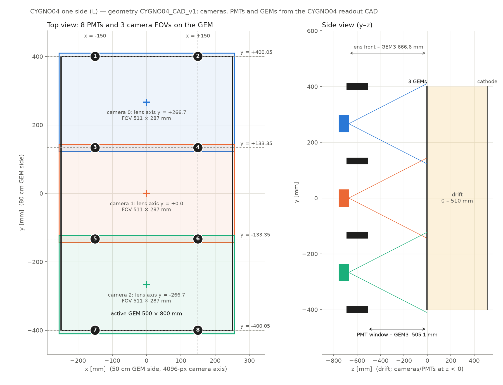

# `twin-cygno04` vs `main`: what changes in the digitizer

Branch `twin-cygno04` of `Oppedix/digitizationpp` = **upstream `CYGNUS-RD/digitizationpp` `main`
(`5e4c810`, 2026-11-17) + the additions below**, including the expected-light export merged from branch
`batman` (§4.6). Fork `main` is a copy of upstream `main` at `f250be5` (2026-11-04); the newer upstream commits are only in this branch.
Line numbers refer to this branch. They are written as `file:line` and link to the line on GitHub.

**Rule kept throughout:** with no new keys, or the new keys at their defaults, the digitizer does what upstream
`main` does. Every addition is either a new option or runs only under `twin_cygno04_mode: True`.

## 1. Ways to run it

| Mode | Config | What you get |
|---|---|---|
| **Standard (upstream)** | `config/ConfigFile_new.txt` (LIME, 4 PMTs) | Same output as upstream `main` (§2) |
| **CYGNO04, 1 camera + 8 PMTs** | `config/ConfigFile_CYGNO04_8PMT.txt` | Standard digitizer with `pmt_number: 8`: Quest2 central camera and 8 waveform pairs `wav_fast/slow_pmt1..8`. All legacy options still work (pedestal `bckg`, `Vignetting`, `redpix_output`, `digitizers`, random shifts, `fixed_seed`, PSD noise) |
| **TWIN ML datasets** | `config/ConfigFile_TWIN_CYGNO04.txt` | `twin_cygno04_mode: True`: camera, XY and depth chosen per track, `ml_*`/`obs_*` truth records ([TWIN_SCHEMA.md](TWIN_SCHEMA.md)) |

The standard digitizer also runs camera-only (`pmt_mode: False`) or with any 1–8 PMTs (`pmt_number`).
Step-by-step recipes for every mode: [TWIN_SCHEMA.md, Usage](TWIN_SCHEMA.md#usage). Output of each mode: §5.

## 2. Verified identical to upstream `main`

`tests/compare_with_upstream.py` builds upstream `main` (`5e4c810`) and this branch with the same dependency
stubs: no ROOTANA and no OpenCV. Both run on the same 8-event MC fixture with upstream's `ConfigFile_new.txt`,
`fixed_seed: True`, `bckg: False`, vignetting and PMTs off, one thread, GEM1 and GEM2 at 400 V to shorten the run. The events take every route of the
charge simulation: a small track (sparse map), a 30 keV track (dense, one slab), a 300 keV track (dense,
several slabs), a 110 keV nuclear recoil (sparse map in `WID` batches), an empty event, a track crossing the
GEM plane, a track crossing `max_drift`, and an event below `ion_pot`. The run is repeated with
`primary_granularity` off and on and `sigma0_light` 0 and 0.2 mm.

* All 32 camera images are **pixel-identical**, and so are the 29 numeric `event_info` branches.
* The only difference is `particle_type` of the empty event. Upstream reads `pdgID_hits[0]` of an empty vector,
  which is undefined behaviour (here it repeats the previous event); this branch writes 0
  ([DigitizationRunner.cxx:893](../src/DigitizationRunner.cxx#L893)).
* Not in this comparison, and not touched by the last merge: the sparse output (`redpix_output: True`), the
  `param_dir` values and the PMT branches. They were compared with the previous upstream `main` (`f250be5`):
  identical, except for the new branch `pmt_signal_valid`. PMT waveform values are random in both versions
  (non-seeded `random_device`); their lengths are identical.

Repeat it after every merge of upstream: §10.

## 3. Upstream changes merged

### 3.1 PR #59: `min_drift` / `max_drift`, one check kept here

Upstream replaced `drift_length` with the response interval `[min_drift, max_drift]`, with defaults 0 and 510 mm.
Its first check rejected the default 0; upstream now accepts 0 (`03bb080`), but checks neither the order of
the two values nor the removed key. This branch keeps the check into one helper, [DriftRange.h:11](../include/DriftRange.h#L11), used by both the
runner and TWIN:

* **Rules:** `0 <= min_drift < max_drift`, and both values must be finite numbers. The defaults stay 0 and 510.
* **Order check:** a swapped pair (`min_drift: 300`, `max_drift: 200`) or an empty interval is rejected.
  Upstream would accept it and silently select no deposits.
* **Removed key:** an old `drift_length` key now raises a clear error instead of being silently ignored.
* **When it runs:** once in the constructor ([DigitizationRunner.cxx:54](../src/DigitizationRunner.cxx#L54)), before any
  output is opened. The interval is applied at [:1154](../src/DigitizationRunner.cxx#L1154)–[:1157](../src/DigitizationRunner.cxx#L1157).
* **TWIN:** requires `min_drift: 0`; `max_drift` is the drift length inside which every track is placed, 510 mm in the CYGNO04 configs ([TwinPlacement.h:47](../include/TwinPlacement.h#L47)).
* **Tests:** [test_twin.cxx:96](../tests/test_twin.cxx#L96) covers the defaults, the shipped values, the swapped and empty
  intervals, negative/NaN/inf/non-numeric values, `drift_length`, and the TWIN rules (`min_drift` 0, drift length from `max_drift`).
* **Configs:** every config states the rule on its `min_drift`/`max_drift` lines
  ([ConfigFile_new.txt:27](../config/ConfigFile_new.txt#L27)–28).
* Upstream's second commit (`a079ff8`, setSeed revert) changes nothing here; this branch already had that `setSeed`.

The three earlier drift-boundary fixes (fractional negative z, z ≥ 0 only, upper cut) are already upstream.

### 3.2 PR #61 and #62: charge sampled once, per-primary diffusion, light blur

Upstream `main` of 2026-11-17 (`5e4c810`) changes how the charge cloud is built. All of it is in
`TrackProcessor.cxx` and applies to every mode, TWIN included. Upstream's own description of the whole chain
is [flow.md](../flow.md); where it says "PMTs 1–4" and "PMT generators are not seeded", this branch differs (§4.2, §4.5).

| What | Effect |
|---|---|
| **Charge sampled once** ([TrackProcessor.cxx:64](../src/TrackProcessor.cxx#L64)–83) | The primary electrons and the GEM1/GEM2 gain of a track are drawn once. Before, a bright track that was processed in several depth slabs drew its charge again for every slab, so each slab saw a different track. This is a bug fix: it changes dense, high-energy tracks |
| **Dense route rewritten** ([:388](../src/TrackProcessor.cxx#L388)–543) | Each electron is given to exactly one depth bin (binomial draws), then spread in x and y in blocks of at most 65,536. Memory no longer grows with the track energy. Electrons that diffuse outside the voxel grid are dropped |
| **New key `primary_granularity`** ([:70](../src/TrackProcessor.cxx#L70), [:1210](../src/TrackProcessor.cxx#L1210)) | `True`: each primary electron diffuses once during the drift (σ² = coefficient × z), and its avalanche electrons spread around it by σ₀ only, so the electrons of one avalanche stay together. `False` or absent: every avalanche electron diffuses on its own with σ² = σ₀² + coefficient × z, as before. The total spot width is the same; the local charge density, and with it the GEM3 saturation, is higher with `True` |
| **New key `sigma0_light`** ([:602](../src/TrackProcessor.cxx#L602)–624, [:1166](../src/TrackProcessor.cxx#L1166)) | Extra Gaussian blur, in mm, of the light of GEM3, applied to the camera image after the saturation and before vignetting and the Poisson draw. It does not change the saturation and does not act on the PMTs. Absent or 0: off |
| **Fixed seed per batch** ([:849](../src/TrackProcessor.cxx#L849)) | With `fixed_seed: True`, each batch of hits gets its own seed |

* **Values here:** the TWIN config sets `primary_granularity: True` and `sigma0_light: 0.2054` mm. The spot of a
  point at zero drift is then σ² = 0.04127 + 0.2054² = 0.08346 mm² on the camera, and 0.04127 mm² for the
  saturation and the PMTs. `ConfigFile_CYGNO04_8PMT.txt` keeps `False` and 0. Both are config values; no code changes with them.
* **Conflicts:** three. The dense route and the fixed-seed line are upstream's, with the TWIN lines put back
  (decimal light per voxel, [:529](../src/TrackProcessor.cxx#L529); TWIN seeding, [:848](../src/TrackProcessor.cxx#L848)).
  The drift interval stays in `DriftRange.h` (§3.1).
* **Expected light (§4.6):** with `sigma0_light` > 0 the exported λ is the blurred one, the mean the Poisson draw uses.
* **Tests:** `tests/run_twin_ml_tests.py` runs the fluorine sample with both options on: same seed, same record.

## 4. Changes, row by row

Each row gives where the change is, what it does, and how. Rows in §4.1–4.4 apply to every mode. Rows in §4.5
run only with `twin_cygno04_mode: True`; with it off, the standard path is the upstream one (§2).

### 4.1 Drift interval (all modes)

| Code | What changed | How |
|---|---|---|
| [DriftRange.h:11](../include/DriftRange.h#L11) | New helper `activeDriftRange` | Reads `min_drift`/`max_drift` (defaults 0 and 510 mm). Rejects text that is not a number, negative/NaN/infinite values, `max_drift <= min_drift`, and the removed key `drift_length` |
| [DigitizationRunner.cxx:54](../src/DigitizationRunner.cxx#L54) | Checked at start-up | A bad interval stops the run before any output file or download |
| [DigitizationRunner.cxx:1154](../src/DigitizationRunner.cxx#L1154)–[:1157](../src/DigitizationRunner.cxx#L1157) | Interval applied | Only deposits with `min_drift <= z <= max_drift` produce light. Track metadata still uses every hit |

### 4.2 PMTs: 1–8 channels (all modes)

| Code | What changed | How |
|---|---|---|
| [PMTHits.cxx:17](../src/PMTHits.cxx#L17), [PMTHits.h:44](../include/PMTHits.h#L44) | New `validateGeometry` | `pmt_number` must be a whole number 1–8. Every `pmt_N_x/y`, `pmt_radius` and `dist_gem_pmt` must be a finite number, radius and distance positive. A `'REQUIRED'` placeholder fails |
| [DigitizationRunner.cxx:60](../src/DigitizationRunner.cxx#L60) | Called at start-up | Geometry errors stop the run before any download |
| [PMTSignal.cxx:163](../src/PMTSignal.cxx#L163)–165 | Waveforms for `pmt_1..pmt_number` | Upstream always simulated 4 PMTs |
| [DigitizationRunner.cxx:710](../src/DigitizationRunner.cxx#L710) | Output arrays sized by `pmt_number` | Sized once and never resized, because ROOT keeps the addresses |
| [DigitizationRunner.cxx:802](../src/DigitizationRunner.cxx#L802) | Output branches | `wav_fast_pmtN` / `wav_slow_pmtN` for N = 1..`pmt_number` (LIME names unchanged), plus the new `pmt_signal_valid` |
| [DigitizationRunner.cxx:1275](../src/DigitizationRunner.cxx#L1275) | `pmt_signal_valid` filled | 1 if that PMT collected at least one photoelectron, else 0 |
| [DigitizationRunner.cxx:825](../src/DigitizationRunner.cxx#L825) | Per-event reset | Events without light keep **empty** waveforms, as upstream. Only TWIN fills them with zeros to the window length |

### 4.3 PMT noise options (all modes)

| Code | What changed | How |
|---|---|---|
| [PMTSignal.cxx:196](../src/PMTSignal.cxx#L196), [:238](../src/PMTSignal.cxx#L238) | New key `pmt_noise` | Accepts `True/true/1` or `False/false/0`, anything else is an error. Missing means `True` (upstream behaviour). `False` sets the noise to zero and skips the template download |
| [PMTSignal.cxx:203](../src/PMTSignal.cxx#L203), [:245](../src/PMTSignal.cxx#L245) | New key `pmt_noise_channels` | `';'`-separated positive integers, one per PMT. PMT *i* reads the noise template of channel *list[i]*. Missing means PMT *i* uses template *i*, as upstream |
| [PMTSignal.cxx:271](../src/PMTSignal.cxx#L271) | PSD length check | A missing or too-short template is an error. Upstream read past the end of the array |

### 4.4 Small fixes (all modes)

| Code | What changed | How |
|---|---|---|
| [DigitizationRunner.cxx:893](../src/DigitizationRunner.cxx#L893) | `particle_type` of an event without hits | Written as 0. Upstream read the first element of an empty list (undefined behaviour) |
| [DigitizationRunner.cxx:292](../src/DigitizationRunner.cxx#L292) | Missing vignetting map | The run stops with `Vignetting map not found` and the path. Upstream used the unopened file (crash) |
| [DigitizationRunner.cxx:329](../src/DigitizationRunner.cxx#L329) | Reading a pedestal frame | It no longer changes the directory the output is written to. Before, a file whose last event was skipped lost its whole `event_info` tree |
| [DigitizationRunner.cxx:237](../src/DigitizationRunner.cxx#L237) | Text settings in `param_dir` | Text-valued keys (`pmt_noise_channels`, `twin_*` names) are skipped when the config is saved as numbers |

### 4.5 TWIN mode (`twin_cygno04_mode: True` only)

| Code | What changed | How |
|---|---|---|
| [DigitizationRunner.cxx:56](../src/DigitizationRunner.cxx#L56)–57, [TwinPlacement.h:24](../include/TwinPlacement.h#L24)–51, [TwinML.h:91](../include/TwinML.h#L91) | Start-up checks | Verified geometry, every `REQUIRED` key filled, and the fixed settings (8 PMTs, both digitizers, synthetic PMT noise, `min_drift: 0`, no exposure effect; with `bckg: True`, a pedestal file named after its runs, versioned build). Any failure stops the run |
| [DigitizationRunner.cxx:509](../src/DigitizationRunner.cxx#L509), [TwinML.h:19](../include/TwinML.h#L19) | Input checks | Every needed MC branch and `tree1` must exist, and event numbers must be unique, before any output is written |
| [DigitizationRunner.cxx:1052](../src/DigitizationRunner.cxx#L1052) | Light source | The response uses `energyDep_hits_QF` for electron and nuclear recoils alike |
| [TwinPlacement.h:14](../include/TwinPlacement.h#L14), [:81](../include/TwinPlacement.h#L81) | Track placement | A hash of the parent ID and `twin_master_seed` picks one of 3 cameras and one XY shift that keeps **all** hits inside that camera's view and the GEM (up to 10000 tries). Z gets one uniform shift over the range that keeps the whole track between the GEM and `max_drift`; with `twin_depth_mm` the energy-weighted centroid is put at that depth instead. Another `variant_id` gives another depth draw with the same camera and XY |
| [TwinPlacement.h:73](../include/TwinPlacement.h#L73)/[:77](../include/TwinPlacement.h#L77), [DigitizationRunner.cxx:1094](../src/DigitizationRunner.cxx#L1094), [:1246](../src/DigitizationRunner.cxx#L1246) | Two frames | The camera image is drawn in the chosen camera's own frame. PMT light is computed back in the GEM frame, so all 8 PMTs see the event where it really is |
| [TrackProcessor.cxx:148](../src/TrackProcessor.cxx#L148), 273/367/529, [:666](../src/TrackProcessor.cxx#L666), [:671](../src/TrackProcessor.cxx#L671) | Photon counts as decimals | No rounding per voxel or pixel. The standard path still rounds, as upstream |
| [DigitizationRunner.cxx:1224](../src/DigitizationRunner.cxx#L1224) | PMT photoelectron yield | photons × `photons_per_el` × `twin_pmt_quantum_efficiency`. The standard path keeps upstream's fixed 0.0136 |
| [TwinML.h:184](../include/TwinML.h#L184), [PMTHits.cxx:88](../src/PMTHits.cxx#L88) | Saturation and PMT truth | Light before and after GEM saturation, summed over the voxels of the track, and the expected photoelectrons per PMT (the sum of the Poisson means the collection samples from) |
| [DigitizationRunner.cxx:1235](../src/DigitizationRunner.cxx#L1235), [:1253](../src/DigitizationRunner.cxx#L1253), [:1263](../src/DigitizationRunner.cxx#L1263), [TwinML.h:140](../include/TwinML.h#L140) | PMT timing | Drift times keep their sign (no `abs`). Time zero is the first photoelectron on any of the 8 PMTs, not the smallest z |
| [TwinML.h:134](../include/TwinML.h#L134), [PMTHits.cxx:53](../src/PMTHits.cxx#L53), [PMTSignal.cxx:58](../src/PMTSignal.cxx#L58), [TrackProcessor.cxx:848](../src/TrackProcessor.cxx#L848), [DigitizationRunner.cxx:81](../src/DigitizationRunner.cxx#L81), [:848](../src/DigitizationRunner.cxx#L848) | Reproducibility | Separate named seeds for charge, collection, single-photoelectron pulses and electronics, all derived from the record seed. One thread. Same input and config give bit-identical output |
| [PMTSignal.cxx:183](../src/PMTSignal.cxx#L183) | Noise | PMTs: seeded Gaussian noise, `twin_pmt_noise_rms_v` per sample; no templates are downloaded. Camera: no synthetic noise; the only camera noise is the real pedestal frame of `bckg: True` |
| [DigitizationRunner.cxx:626](../src/DigitizationRunner.cxx#L626), [:638](../src/DigitizationRunner.cxx#L638) | Image file | Records always go to `digi_RunXXXXX.root`. With `redpix_output: False` the full images go to `histograms_RunXXXXX.root`, as integer counts like the standard digitizer's |
| [DigitizationRunner.cxx:948](../src/DigitizationRunner.cxx#L948), [TwinML.h:194](../include/TwinML.h#L194) | Real pedestals | `bckg: True` uses the pedestal runs of `noiserun` (one or more) through the standard pedestal file. The frame is drawn from the record seed and saved as `pedestal_frame`. The file name must contain every run number, so a file built from other runs is never reused and the pools of different splits stay apart |
| [TwinML.h:147](../include/TwinML.h#L147), [:158](../include/TwinML.h#L158), [DigitizationRunner.cxx:719](../src/DigitizationRunner.cxx#L719), [:842](../src/DigitizationRunner.cxx#L842) | ML record | One record per MC event: truth (`ml_*`), observables (`obs_*`) and audit branches (§5) |
| [DigitizationRunner.cxx:467](../src/DigitizationRunner.cxx#L467) | Legacy sparse pixels | `redpix_iz` is capped at 65535 and `ml_legacy_sparse_clipped` is set. Use `obs_camera_*` instead |
| [DigitizationRunner.cxx:1297](../src/DigitizationRunner.cxx#L1297) | `N_photons` | Written as −1. The upstream integer sum can overflow with decimal counts |
| [DigitizationRunner.cxx:1088](../src/DigitizationRunner.cxx#L1088), [:1284](../src/DigitizationRunner.cxx#L1284) | Failures | A failing event becomes a record with `ml_valid = False` and a reason. The run continues |
| [CMakeLists.txt:98](../CMakeLists.txt#L98), [TwinML.h:125](../include/TwinML.h#L125), [DigitizationRunner.cxx:642](../src/DigitizationRunner.cxx#L642) | Provenance | CMake compiles in the git commit (`-dirty` if there are local changes). TWIN files store it with the full config |

### 4.6 Expected-light export (all modes, merged from branch `batman`)

Off unless `save_expected_lambda: True`. The TWIN config switches it on.

| Code | What changed | How |
|---|---|---|
| [TrackProcessor.cxx:629](../src/TrackProcessor.cxx#L629), [:661](../src/TrackProcessor.cxx#L661), [DigitizationRunner.cxx:699](../src/DigitizationRunner.cxx#L699), [:785](../src/DigitizationRunner.cxx#L785) | Expected light per pixel | Every pixel with expected light λ > 0 is written as `expected_ix`, `expected_iy`, `expected_lambda_e`: the expected number of detected photoelectrons **before** the Poisson draw, after vignetting, lens acceptance and quantum efficiency. Pixel indices are those of `redpix_ix/iy` and `obs_camera_ix/iy` |
| [TrackProcessor.cxx:666](../src/TrackProcessor.cxx#L666) | Poisson draw | Uses the same λ. The number and the random draws are unchanged, in the standard path and in TWIN mode (merge conflict resolved here) |
| [DigitizationRunner.cxx:1182](../src/DigitizationRunner.cxx#L1182), [:1288](../src/DigitizationRunner.cxx#L1288) | Error paths | A skipped track and an invalid TWIN record have empty expected-light vectors |

## 5. What the digitizer writes

### Modes A–D (ordinary digitizer)

The same files as upstream: `histograms_RunXXXXX.root` with camera images `pic_run*_ev*`, or `digi_RunXXXXX.root`
when `redpix_output: True`, each with the tree `event_info` and the `param_dir` settings. The only differences:

| Output | Upstream | This branch |
|---|---|---|
| `wav_fast_pmtN`, `wav_slow_pmtN` | N = 1–4 | N = 1..`pmt_number` (1–8) |
| `pmt_signal_valid` | — | `vector<int>[pmt_number]`, 1 = PMT collected light |
| `particle_type` of an event without hits | undefined | 0 |
| `expected_ix`, `expected_iy`, `expected_lambda_e` | — | Only with `save_expected_lambda: True` (§4.6) |

With `pmt_mode: False` no PMT branch is written.

### Mode E (TWIN)

Two files per input file. `digi_RunXXXXX.root` holds the records (tree `event_info`, below) and is the file to keep.
With `redpix_output: False`, `histograms_RunXXXXX.root` is written too: one image `pic_run<N>_ev<M>` per valid
record, signal plus the pedestal frame when `bckg: True`, in the format the reconstruction reads. `M` is the
row of the record in `event_info`. A rejected record has no image.

Added to every `event_info` row:

| Group | Branches | Content |
|---|---|---|
| **Model inputs** | `obs_camera_width`, `obs_camera_height` | Size of the camera image. The image itself is in `histograms_RunXXXXX.root` |
| | `wav_fast_pmt1..8`, `wav_slow_pmt1..8` | All 8 PMTs, fixed length (`fast_window_len`, `slow_window_len`), in volts |
| **Signal without noise** | `obs_camera_ix`, `obs_camera_iy`, `obs_camera_signal` | Sparse camera signal before noise, exact (decimal counts) |
| | `expected_ix`, `expected_iy`, `expected_lambda_e` | Expected photoelectrons per pixel before the Poisson draw (§4.6); truth, not a model input |
| | `pmt_signal_valid` | Which PMTs collected light (simulation flag, not a model input) |
| **Truth** (`ml_*`, 31 branches) | `ml_hit_x/y/z_mm`, `ml_hit_evis_keV`, `ml_hit_edep_keV` | Every hit after placement, with visible and raw energy |
| | `ml_initial_ux/uy/uz`, `ml_direction_valid`, `ml_primary_energy_MeV`, `ml_primary_vertex_mm` | Generated direction, energy and vertex from `tree1` |
| | `ml_primary_pdg`, `ml_class_nr`, `ml_evis_total_keV`, `ml_z_centroid_mm` | Particle, NR/ER class, visible energy, depth |
| | `ml_photons_unsaturated`, `ml_photons_saturated` | Avalanche light of the track before and after GEM saturation, in photons |
| | `ml_pmt_expected_pe` | Expected photoelectrons on each PMT: the mean of what is sampled |
| | `ml_parent_id`, `ml_variant_id`, `ml_response_id`, `ml_seed`, `ml_camera_id`, `ml_side_id`, `ml_placement_xyz_mm`, `ml_source_file_id` | Track identity and placement |
| | `ml_valid`, `ml_reject_reason`, `ml_response_hit_index`, `ml_legacy_sparse_clipped`, `ml_schema_version` | Quality and audit |
| **Audit** | `camera_id`, `selected_side`, `parent_id`, `variant_id`, `pedestal_frame`, `target_depth_mm`, `actual_depth_mm`, `visible_ionization_weights`, `source_x/y/z`, `source_px/py/pz` | Placement inputs and the original MC hits |

All upstream `event_info` branches are still written, with `N_photons = −1` and `redpix_iz` capped (§4.5).

**File-level objects** in TWIN files: `twin_configuration` (every config key and value), `digitizer_commit`,
`root_version`, `reproducibility`, `ionization_convention`.

Types, units and which branches may be model inputs: [TWIN_SCHEMA.md](TWIN_SCHEMA.md). How to run each mode:
[TWIN_SCHEMA.md, Usage](TWIN_SCHEMA.md#usage).

## 6. New settings (all optional for the standard digitizer)

| Key | Default | Meaning |
|---|---|---|
| `min_drift`, `max_drift` | 0, 510 mm | Upstream keys. Deposits with z outside the interval are excluded from the response. Rule: `0 <= min_drift < max_drift`. `drift_length` is no longer accepted |
| `primary_granularity`, `sigma0_light` | `False`, 0 | Upstream keys (§3.2): per-primary diffusion; blur of the GEM3 light in mm. The TWIN config sets `True` and 0.2054 mm; `ConfigFile_CYGNO04_8PMT.txt` writes the defaults |
| `pmt_number` | 4 | Now 1–8 |
| `pmt_noise` | `True` | `False` gives noiseless PMT waveforms |
| `pmt_noise_channels` | identity | `';'`-separated PSD template channel per PMT |
| `drift_velocity` | absent: built-in table at `drift_field` | Drift velocity in cm/µs used for the PMT arrival times ([Utils.cxx:118](../src/Utils.cxx#L118), [DigitizationRunner.cxx:1222](../src/DigitizationRunner.cxx#L1222)). Must be a positive number; checked at start-up. The table gives 5.91 at 0.95 kV/cm, the TWIN config sets 6.25305 |
| `save_expected_lambda` | `False` | Writes the sparse expected light `expected_ix`, `expected_iy`, `expected_lambda_e` (§4.6) |
| `twin_depth_mm` | absent: one uniform depth per track | TWIN only. Fixed depth of the charge centroid in mm, between 0 and `max_drift` (diagnostic set) |
| `twin_cygno04_mode` | `False` | Enables TWIN. All `twin_*` keys, `variant_id` and the `REQUIRED` per-run inputs are documented inline in `ConfigFile_TWIN_CYGNO04.txt` |

Each key is commented where it is used: [ConfigFile_new.txt:27](../config/ConfigFile_new.txt#L27), [:104](../config/ConfigFile_new.txt#L104)–106, [:137](../config/ConfigFile_new.txt#L137); [ConfigFile_CYGNO04_8PMT.txt:1](../config/ConfigFile_CYGNO04_8PMT.txt#L1)–12 (how to switch camera) and [:117](../config/ConfigFile_CYGNO04_8PMT.txt#L117)–124.

## 7. CYGNO04 geometry and PMT positions (`CYGNO04_CAD_v1`)



Regenerate the figure with `python3 tools/plot_cygno04_geometry.py`.

Cameras, PMTs and the GEM stack come from the **CYGNO04 readout CAD** provided by the CYGNO collaboration
(`CAMERAS+PMT+GEM`, the same assembly as `.FCStd`, `.step` and `.stl`; not stored in the repository, 18–85 MB).
[tools/extract_cygno04_cad.py](../tools/extract_cygno04_cad.py) reads it with FreeCAD and prints every CAD value
in the table:

```
CYGNO04_CAD=/path/to/CAMERAS+PMT+GEM.FCStd freecadcmd tools/extract_cygno04_cad.py
```

**Frames.** In the CAD part `Cygno04 - Detector`, +X is the GEM normal pointing to the optics, Y is the 50 cm
GEM side and Z the 80 cm side. Digitizer: x = CAD Y, y = CAD Z, and z is the drift distance from the
drift-side GEM foil (z > 0 towards the cathode).

| Quantity | Value | Source |
|---|---|---|
| GEM stack | 3 foils at 2.1 mm pitch; the camera-side foil (GEM3) ends 4.3 mm from the drift-side face of GEM1 | CAD |
| GEM foil outline | 529 × 829 mm, centred within 1.2 mm of the middle camera axis | CAD |
| Active GEM | x ∈ ±250, y ∈ ±400 mm | `CYGNUS-RD/geometry` `cygno_04_v3` @ `dbf18a3` |
| Drift | 510 mm. The sensitive gas ends 510.03 mm from the cathode plane (MC z = 0) on both sides | CYGNO-MC `fiorotto8/CYGNO-MC` `master` @ `316c09d`, nominal detector. The readout CAD agrees: GEM1 is 510.0 mm from the central plane |
| Cameras | 3 × ORCA-Quest2 with EHD-25085-C lens (25 mm, f/0.85). Optical axes normal to the GEM at x = 0, **y = +266.7 / 0 / −266.7 mm**. Lens front 666.6 mm from GEM3 | CAD |
| FOV per camera, TWIN config | 510.77 × 287.31 mm (0.1247 mm/px, measured full-field average), 4096-px axis along x | [FoV scan report](https://fiorotto8.github.io/FoV_Scan/report.html), 655 mm foil–lens distance (TWIN v2 plan §3) |
| FOV per camera, one-camera 8-PMT config | 532.48 × 299.52 mm (0.130 mm/px), unchanged | [arXiv:2510.01646](https://arxiv.org/abs/2510.01646) p.70 |
| **PMTs** | 8 × 1-inch tubes (body Ø 26 mm, window radius 11.5 mm). **x = ±150; y = ±133.35, ±400.05 mm; window 505.1 mm from GEM3** (`dist_gem_pmt`) | CAD |
| `pmt_radius` | 11 mm | R7378A effective photocathode; fits inside the 11.5 mm CAD window |
| MC → digitizer | `x,y,z`, `z_offset 510.03` (side L, `/CYGNO/lab/select NoCave`). Side R: `-x`, `-z`, 510.03. In TWIN mode every track is re-placed, so only the axis orientation matters | CYGNO-MC `master` |

**Layout.** The PMTs form two columns at x = ±150 mm. The four rows sit on the camera FOV seams
(y = ±133.35 mm, half the 266.7 mm camera spacing) and on the outer FOV edges (y = ±400.05 mm, 1.5 × the spacing).

**FOV cross-check.** For a thin 25 mm lens with the Quest2 sensor (4096 × 4.6 µm) at the C-mount flange
distance (17.526 mm behind the lens flange), the CAD sensor–GEM3 distance of 769.6 mm gives a demagnification of
28.8, i.e. **0.132 mm/px**. This agrees with the 0.130 mm/px FOV within 2 %; 0.152 mm/px would need about 880 mm.
The measured 0.1247 mm/px used by the TWIN config is 6 % below this thin-lens estimate, and the report's 655 mm
foil–lens distance is 11.6 mm shorter than the CAD lens-front distance (666.6 mm). Not reconciled here; the
measurement is used.

**Sensor orientation.** The 4096-px axis must lie along x: with the sensor turned by 90°, the 287 mm FOV side
could not cover the 500 mm GEM side.

**Numbering.** PMT 1–8 and camera 0–2 (figure) are the digitizer's convention. The CAD carries no readout channel
numbers, so map them to DAQ channels before comparing with data.

**One-camera 8-PMT config.** PMT XY are given relative to the **simulated** camera centre (central camera →
same as GEM XY). For another camera, subtract its y (±266.7 mm) and set `y_offset` (see the config header).

Other sources:
* [arXiv:2512.01762](https://arxiv.org/abs/2512.01762)
* [arXiv:2603.22595](https://arxiv.org/abs/2603.22595)
* [IDM2026 slides, S. Piacentini](https://indico.capa.unizar.es/event/40/contributions/862/attachments/618/1369/IDM2026_Piacentini.pdf) p.10
* [CYGNUS-RD/WIKI-documentation CYGNO-04](https://github.com/CYGNUS-RD/WIKI-documentation/tree/main/CYGNO-04)

## 8. TWIN placement rules (summary)

* One run places every track once: camera, XY and depth. For fixed depths set `twin_depth_mm` and run once per
  depth, into separate output folders.
* The parent ID is `twin_source_id/<ROOT file UUID>:eventnumber`. The camera and XY draws depend only on the
  parent, the side and `twin_master_seed`; the depth draw also depends on `variant_id`.
* A shift must keep **all** hits inside the FOV and the GEM; up to 10000 attempts are made. Hits are never
  removed or truncated. A track longer than the drift, or one that a fixed depth pushes outside 0–`max_drift`, is rejected, and the
  record says why.
* `exposure_time_effect` must be `False`. NR-only filtering and the `ion_pot` early exit are bypassed, so
  every parent gives a record.

## 9. Known limits / not tested here

* **Not tested here:** the full CMake build with ROOTANA and OpenCV (pedestal download, measured PSD noise
  IFFT), and real CYGNO-MC files. All tests in §10 and the §2 comparison use stubs for these two libraries only.
* **Calibration gaps:**
  * the TWIN config names the Davide–Melba map `vignette_ORCA_calibrated.root`, which is **not in the repository**:
    it is kept on the CNAF cluster and must be copied by hand into `VignettingMap/` before running. It has not
    been run here, and the tests switch vignetting off;
  * gas, diffusion, gain and saturation in the TWIN config are the Davide–Melba working values (TWIN v2 plan §3),
    not a final calibration;
  * the PMT electronics/SPE constants and noise templates are LIME values;
  * the TWIN PMT trigger is ideal (first photoelectron).
* **Inherited from upstream:** the PMT acceptance r²h²/(4R⁴) has one extra cos θ compared with the exact
  small-disk solid angle, and photon counts are rounded per voxel. The renderer aligns each charge box to the
  pixel grid by rounding its centre, so light within half a pixel of the image edge can be dropped: 0.06 mm at
  the Quest2 scale, 6 mm with the 12.5 mm pixels of the test fixtures.
* **Not in the readout CAD:** the cathode and field cage. The active GEM area comes from `cygno_04_v3`; the drift
  length and `z_offset` come from the nominal detector of CYGNO-MC `master`. The GEM position in the v4 CAD
  file itself has not been read.
* **Lens aperture:** the TWIN config uses the CAD lens value f/0.85; the one-camera 8-PMT config keeps 0.95
  (LIME value). The camera light factor scales as 1/aperture², so f/0.85 gives 25 % more light; the overall
  scale `A` still needs calibration.
* **Pedestals:** `bckg: True` needs pedestal runs of the same camera; the code stops on a Fusion/Quest mismatch.
  Building the pedestal file from MIDAS runs needs ROOTANA and has not been run here: the tests read a
  ready-made pedestal file. A record does not say which run its frame came from, only the frame index in the
  file; the runs of the file are in `param_dir/pedestal_runs`.

## 10. Tests

```
python3 tests/run_pmt_tests.py [--without-opencv]   # 4 and 8 PMTs, noise switch/remap, legacy vs TWIN reset, ROOT round trip
python3 tests/run_twin_ml_tests.py                  # actual runner in TWIN mode, 8 waveforms, reproducibility
c++ -std=c++17 -Iinclude tests/test_twin.cxx src/PMTHits.cxx -o /tmp/t && /tmp/t
c++ -std=c++17 -Iinclude tests/test_cygno04_geometry.cxx src/ConfigManager.cxx src/PMTHits.cxx $(root-config --cflags --libs) -o /tmp/g && /tmp/g   # configs match the CAD values
python3 tests/compare_with_upstream.py <upstream checkout>   # standard path against upstream main, pixel by pixel (§2); 5 minutes
```
