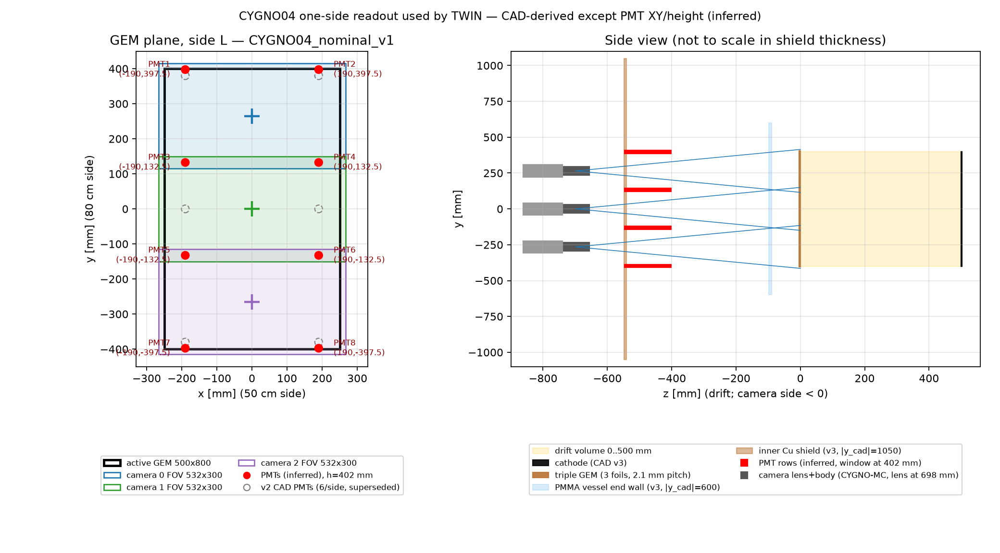

# CYGNO04 one-side readout geometry: `CYGNO04_nominal_v1`

This is the geometry now set in `config/ConfigFile_TWIN_CYGNO04.txt`. It was put
together on 2026-11-04 from public CAD, the CYGNO-MC source and published
CYGNO-04 descriptions. Each value below is marked **stated**, **CAD** or
**inferred**. **No public source gives the XY coordinates or the GEM distance
of the 8 PMTs per side**, so those are inferred. That is why the config still
ships with `twin_geometry_verified: False`. Set it to `True` only after the CYGNO
hardware/mechanics group confirms the values. The private TDR on the
collaboration Drive is the obvious place to check.



Regenerate the figure with `python3 tools/plot_cygno04_geometry.py` (needs matplotlib).
Check consistency with:

```
c++ -std=c++17 -Iinclude tests/test_cygno04_geometry.cxx src/ConfigManager.cxx src/PMTHits.cxx \
    $(root-config --cflags --libs) -o /tmp/test_geo && /tmp/test_geo config/ConfigFile_TWIN_CYGNO04.txt
```

## Frames

* **CAD (geometry repo `cygno_04_v3`)**: drift along CAD y, cathode at y = 0, GEM
  at |y| ≈ 501–506 mm, 50 cm side along CAD x (centre −470), 80 cm side along CAD z.
* **CYGNO-MC (`g4v11.3_cygno04` @ 7464329)** places the CAD with `rotX(−90°)` and a
  +470 mm x shift (`CYGNODetectorConstruction.cc:670–672`). This gives
  MC x = CAD x + 470, MC y = CAD z, MC z = −CAD y. Drift is along MC z; the cameras sit at
  MC z = ∓1200 mm. Hits are stored in **world** coordinates
  (`CYGNOSensitiveDetector.cc:68`). Only `/CYGNO/lab/select NoCave` puts the TPC at
  the world origin. With the LNGS cave, add the lab translation to the offsets.
* **Digitization, side L** (`MC_xaxis 'x'`, `MC_yaxis 'y'`, `MC_zaxis 'z'`,
  `z_offset 502.2`): z = 0 at the innermost GEM foil, +z toward the cathode.
  Side R is a 180° rotation about y: `MC_xaxis '-x'`, `MC_zaxis '-z'`,
  `z_offset 501.2`, PMT/camera x → −x. Camera y values do not change.

## Values

| Quantity | Value | Status | Source |
|---|---|---|---|
| Readout per side | 3 ORCA-Quest2 + 8 R7378 PMTs | stated | arXiv:2510.01646 §3.4.2 (p.70); IDM2026 slides p.10 |
| Active GEM / field cage interior | x ∈ [−250, 250], y ∈ [−400, 400] mm | CAD | `cygno_04_v3/Cathode.stl`, `FieldCage.stl` (500 × 800) |
| Drift length | 500 mm (499.95 L / 500.95 R to the cathode face) | CAD | GEM foils at CAD y = +502.2/504.3/506.4 and −501.2/−503.3/−505.4; cathode 2.5 mm |
| MC sensitive gas | 484 × 784 × 470 mm, 10 mm from the cathode | code | `CYGNODetectorConstruction.cc:572–576, 690`. Original hits lie at digitization z ≈ 22–492 mm, and TWIN re-places Z anyway |
| Camera lens centres | (0, +265), (0, 0), (0, −265) mm, 697.8 mm from the GEM | code | CYGNO-MC lines 695–724; matches the stated "73 cm" camera–GEM distance (arXiv:2512.01762 §4.4) |
| Camera orientation | 4096-px axis along x (50 cm side), roll 0 | inferred | landscape camera windows in the CAD end plate (wiki render, thesis Fig. 3.14); 3 × 16:9 tiles cover 800 mm |
| Effective pixel | 0.130 mm → FOV 532.48 × 299.52 mm | stated | arXiv:2510.01646 p.70. Cross-check: f = 25.6 mm at 73 cm gives M ≈ 27.5 and 4.6 µm × 27.5 = 0.127 mm |
| FOV overlap | 34.5 mm at each seam; coverage ±414.8 mm | derived | from the above |
| Camera model | `Quest2`, aperture f/0.95 | stated / LIME | Quest2 in arXiv:2603.22595 §6; lens as LIME (arXiv:2512.01762 §2.2) |
| PMT XY | x = ±190; y = ±132.5, ±397.5 mm | **inferred** | see below |
| PMT window–GEM distance `dist_gem_pmt` | 402 mm | **inferred** | `cygno_04_v2/pmts.stl`: PMT front face at CAD \|y\| = 905, GEM at 503 |
| PMT radius | 11 mm | stated (LIME) | R7378A, as used for LIME |
| PMT QE | 0.15 | stated | arXiv:2510.01646 p.70 (~15 % at 500 nm) |
| Camera noise | 2.8 counts rms | datasheet | Quest2 0.30 e⁻ × (1/0.107) counts/e⁻ (constants already in `prepareCameraSettings`) |
| Vignetting | off | deferred | the repo has only Fusion/MANGO maps. `CYGNUS-RD/reconstruction@cygno04` references `data/vignette_QEHD_085.root`, a candidate to import |

### How the PMT positions were inferred

1. The thesis (arXiv:2510.01646, p.70) says the 8 PMTs "will be positioned at the
   corners of each camera facing the GEMs".
2. The only CAD that contains PMTs is the superseded `cygno_04_v2` layout, with
   2 cameras and 6 PMTs per side. Its PMTs sit at x = ±190 mm and, along the
   long axis, at 0 and ±380 mm. Those are the **shared tile corners** of two camera
   tiles centred at ±190 mm (boundaries at 0 and ±380).
3. The same rule for 3 tiles centred at 0 and ±265 mm puts the tile boundaries at
   ±132.5 (midpoints) and ±397.5 mm (outer edges). Two PMTs per boundary row
   gives **exactly 8**. That count is the main evidence for the rule.
4. x = ±190 mm and the 402 mm height are kept from v2. Both are the least certain
   values. Moving the PMTs mostly changes the light-sharing gradients, not the
   timing.

Alternatives worth testing as systematics: x = ±250 mm (at the field-cage edge);
PMTs on the camera plane (~700 mm); PMTs inside the vessel (< 97 mm, where the
PMMA end wall is). Note that the small round objects next to the cameras in
thesis Fig. 3.13 are connector flanges, not PMTs.

## Drawings in `docs/drawings/`

| File | Content | Origin |
|---|---|---|
| `cygno04_readout_nominal.png` | Top and side view of the geometry above | generated by `tools/plot_cygno04_geometry.py` |
| `thesis_2510.01646_fig3.13_cygno04_setup.png` | Top view: 3 cameras per side, field cages, Cu boxes | F. Antonietti PhD thesis, [arXiv:2510.01646](https://arxiv.org/abs/2510.01646), Fig. 3.13 (drawing: A. Croce, INFN SEM) |
| `thesis_2510.01646_fig3.14_cu_shield_camera_ports.png` | Cu shield with the 3 camera pass-throughs | same, Fig. 3.14 |
| `IDM2026_Piacentini_p10_cygno04_layout.png` | Cross-section, "3 cameras + 8 PMTs per side" | [IDM2026 talk, S. Piacentini](https://indico.capa.unizar.es/event/40/contributions/862/attachments/618/1369/IDM2026_Piacentini.pdf), p.10 |
| `wiki_cygno04_cad_render_2025-05-08.png` | Exploded vessel CAD; end plate with 3 landscape camera windows | [CYGNUS-RD/WIKI-documentation](https://github.com/CYGNUS-RD/WIKI-documentation/tree/main/CYGNO-04) |
| `geometry_v3_cu_pmma_fc_quotes.pdf` | Cu / PMMA / field-cage gap dimensions (81, 99, 140, 180 mm) | [CYGNUS-RD/geometry](https://github.com/CYGNUS-RD/geometry) `cygno_04_v3` @ dbf18a3 |

Third-party figures belong to the CYGNO collaboration and their authors. They are
reproduced here for internal reference only.

Geometry sources were checked at: CYGNUS-RD/geometry `dbf18a3` (2025-11-24),
CYGNO-MC `7464329`, CYGNUS-RD/reconstruction `cygno04` @ `695785f` (2026-09-22).
The reconstruction config uses `pixelwidth 0.152` mm (FOV 623 × 350 mm). That
disagrees with the thesis's 0.130 mm and is the next number to confirm.
